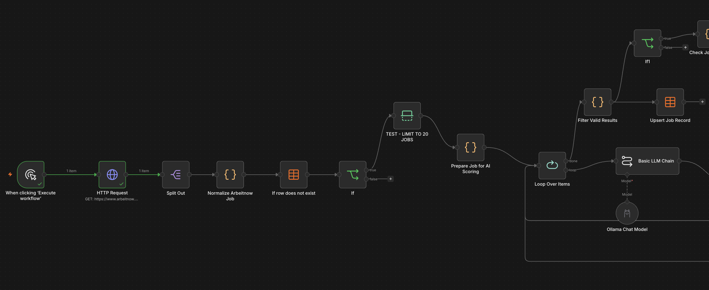
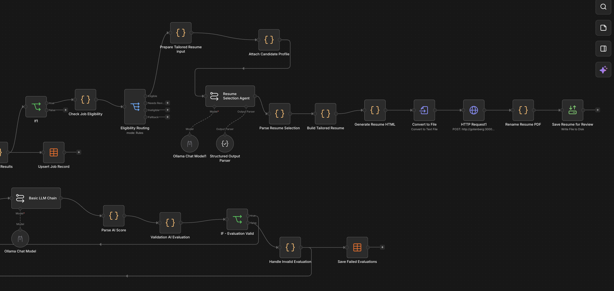

# JobLens — AI Job Matching & Evaluation Platform

A self-hosted AI workflow built with **n8n and Ollama**, combining job discovery, local LLM scoring, deterministic validation, and résumé PDF generation.

JobLens uses my professional profile as a personal case study. Alongside building the workflow, I focus on evaluating its outputs, understanding failures, and documenting exactly what each test demonstrates.

## Key highlights

- **Local AI inference:** Uses Qwen3 through Ollama rather than a paid hosted model API for job scoring.
- **Public job-data API:** Retrieves listings through Arbeitnow without a paid job-data subscription in the demonstrated setup.
- **Self-hosted orchestration:** Runs the workflow locally with n8n, with Gotenberg handling résumé PDF conversion.
- **Evaluation as a core component:** Checks model outputs and inspects workflow behavior alongside implementing functionality.
- **Inspectable results:** Preserves scores, explanations, validation errors, warnings, and processing metadata for review.

The demonstrated local workflow does not require a paid LLM API or cloud subscription. Running it still consumes local computing resources, electricity, and storage; hosted deployment would introduce its own costs.

## Evaluation-first development

Building a workflow that produces an answer is only part of the engineering work. JobLens also examines whether that answer is supported and whether the tested workflow path behaves as expected.

The evaluation approach covers three layers:

1. **Model output:** Inspect fit scores, decisions, matched skills, missing skills, and explanations.
2. **Deterministic validation:** Flag unverified skill claims, decision inconsistencies, and selected requirement-related issues.
3. **Workflow testing:** Reconcile input and output counts, inspect branching, and verify storage or generated artifacts when those paths are included in the test.

In the documented 20-job targeted run, all 20 evaluations completed. Seven passed the current validator and 13 were flagged. Those failures provide concrete cases for reviewing prompts, skill aliases, and validation rules.

This is a bounded integration-test harness with manual inspection—not yet an automated benchmark or a measure of model accuracy. Human-labeled cases and repeatable regression tests are the next step.

## Why I built it

Finding relevant jobs involves repeatedly reviewing descriptions, comparing requirements with experience, and preparing application materials.

JobLens explores how AI can assist this process while keeping its judgments inspectable. The system separates preliminary keyword filtering, model-based matching, output validation, and downstream eligibility checks.

**Current status:** an engineering prototype with tested scoring and validation paths, plus saved résumé artifacts from earlier tests. Full-workflow acceptance testing remains ongoing.

## How it works

```text
Arbeitnow API
    ↓
Job normalization and preliminary role/keyword filtering
    ↓
Prepare job data for local LLM evaluation
    ↓
Score against a verified candidate profile
    ↓
Parse and validate the model output
    ├── Valid evaluation → fit-score filtering
    └── Invalid evaluation → flag for review
    ↓
Intended downstream processing:
job tracking → eligibility checks → tailored résumé → PDF → pending review
```

The workflow includes separate storage paths for valid job records and failed evaluations. Which paths execute depends on the scope of the test.

## Workflow screenshots

### Job discovery and evaluation loop

Retrieving listings, normalizing job data, checking existing records,
applying preliminary filters, and preparing a bounded evaluation batch.



### Validation, eligibility, and résumé generation

Model-output validation, invalid-evaluation handling, eligibility routing,
and the résumé pipeline through PDF generation and saving for review.



These screenshots illustrate the workflow architecture. Test coverage
and observed execution results are documented separately below.

## Technology

| Technology | Purpose |
|---|---|
| n8n | Workflow orchestration, loops, branching, and execution inspection |
| Arbeitnow API | Job-listing discovery |
| Ollama / Qwen3 | Local LLM inference |
| JavaScript | Data preparation, parsing, validation, and routing logic |
| n8n Data Tables | Job and failed-evaluation tracking |
| Gotenberg | HTML-to-PDF résumé conversion |

## Observed discovery and evaluation results

Execution **#371**, on **14 October 2026**, produced this funnel:

| Stage | Observed count |
|---|---:|
| Job listings retrieved | 300 |
| Listings passing preliminary filtering | 29 |
| Listings evaluated under the test limit | 20 |
| Evaluations passing validation | 7 |
| Evaluations flagged by the validator | 13 |
| Items accounted for at loop completion | 20 |

The run completed in **22 minutes 51.451 seconds**.

The 29 listings were selected by preliminary rules; they were not all confirmed relevant. The 20-item limit bounded the test.

### What this test covered

This execution was started using **Execute step on `If1`**. It tested the path leading to that node, including scoring, validation, loop completion, and fit-score routing.

All seven valid evaluations scored below 70 and reached the false branch. Eligibility checking and résumé generation were not exercised by this run.

The separate storage nodes had no output. Consequently, this run **did not establish persistence success or a persistence defect**.

## Evaluation and validation

JobLens distinguishes three tasks:

1. **Job evaluation:** the LLM assesses a listing against the candidate profile.
2. **Output validation:** deterministic rules check the assessment for selected inconsistencies and unsupported claims.
3. **Workflow evaluation:** test inspection checks item counts, branch behavior, storage, and downstream outcomes.

Observed evaluation records include:

- Fit score, decision, and explanation.
- Original model decision and decision-mismatch flag.
- Matched, missing, and normalized skills.
- Unverified matched skills.
- Validation errors and warnings.
- Selected requirement flags.
- Processing timestamps and validator version.

### Validation findings from the 20-job run

| Failure category | Evaluations affected |
|---|---:|
| Unverified matched skills | 9 |
| Original LLM decision mismatch | 3 |
| Unsupported advanced-German requirement | 1 |
| Unsupported leadership requirement | 1 |

Categories overlap: one evaluation had both a decision mismatch and an unverified skill, resulting in **13 rejected evaluations overall**.

An unverified skill means the validator did not recognize it as supported by the configured profile. It may indicate an unsupported model claim, a missing alias, or a difference in terminology. These cases require review.

**The 35% validation acceptance rate is not model accuracy.** Passing the current rules does not prove an assessment is correct, nor does it mean the candidate meets every job requirement.

The current test harness consists of bounded workflow inputs, execution inspection, and manual result reconciliation. A standalone automated benchmark suite is planned.

## Résumé-generation evidence

Earlier tests produced résumé PDFs saved to the workflow’s `pending-review` folder.

A subsequent inspection found **13 readable PDF files**, with modification dates spanning **15 September–12 October 2026**. The files include demo cases and outputs named for specific employers and roles.

Some files are duplicates or repeated test outputs. The file count therefore does not represent 13 distinct applications or 13 independently verified full-workflow runs.

These artifacts support résumé generation and file saving in earlier test scenarios. Matching each artifact to its execution history is needed to establish precisely which upstream stages were exercised.

**Generated résumés remain subject to human review. No application submission is demonstrated by these artifacts.**

## What I learned

- A successful execution must be interpreted within its actual scope.
- Validating an AI assessment is different from determining job suitability.
- Rule-based validators need their own regression tests.
- Failure examples are useful inputs for improving prompts and skill normalization.
- Keyword filtering can still admit unrelated roles.
- Saved artifacts, branch counts, and execution records provide different kinds of evidence.

## Current limitations

- The documented 20-job run was targeted, rather than a complete end-to-end acceptance test.
- Validator acceptance has not been measured against a human-labeled benchmark.
- Requirement detection and skill aliases need broader test coverage.
- Positive eligibility paths were not exercised by the documented batch.
- Earlier résumé artifacts have not all been reconciled with their originating executions.
- Automated application submission and its human-approval flow are not complete.

## Running the project

Follow the [setup guide](docs/setup.md) to configure services,
import the workflow, connect Ollama, create the data tables,
and prepare résumé output storage.

The guide reflects the exported workflow and local configuration.
A clean installation following these instructions has not yet been tested.

## Next steps

- Run and verify complete workflow tests, including both storage branches.
- Add controlled examples for every eligibility route.
- Preserve difficult cases as regression fixtures.
- Improve skill normalization and requirement detection.
- Measure filtering quality and unnecessary model processing.
- Publish a sanitized workflow export and reproducible setup guide.
- Link selected résumé artifacts to their test evidence.
- Add human approval before any future submission capability.
